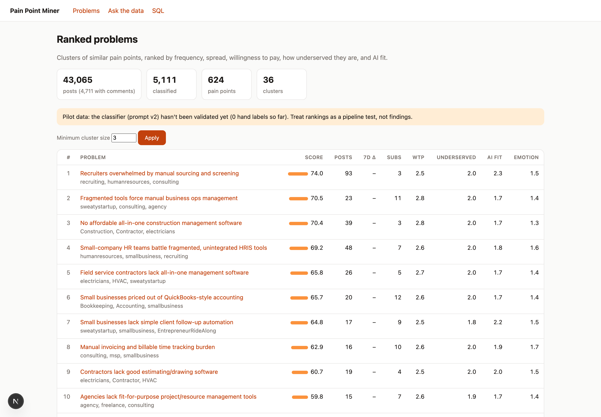
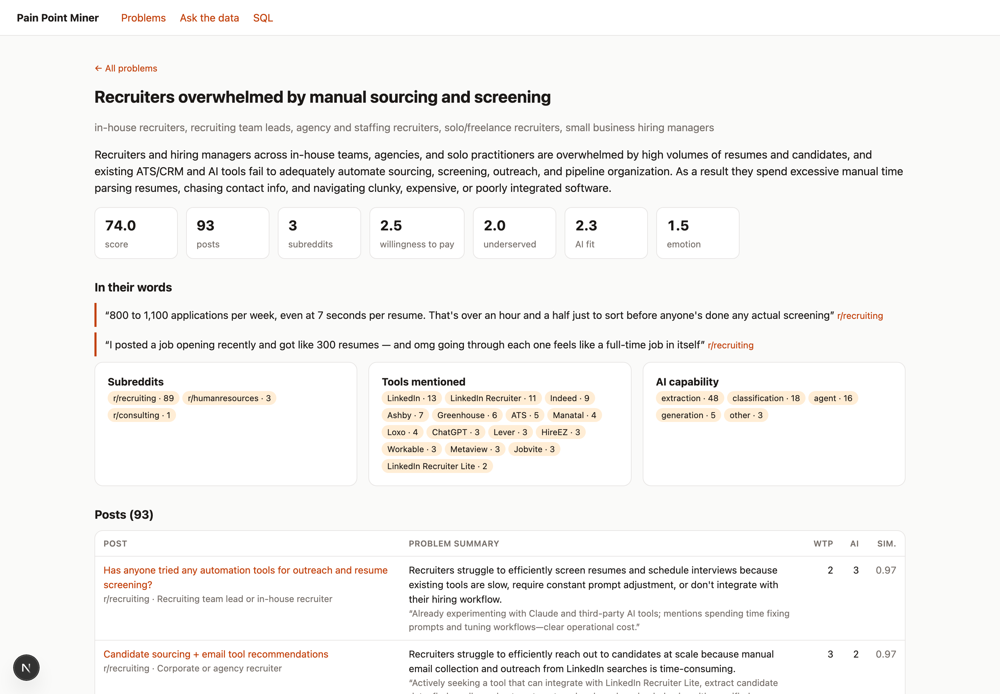
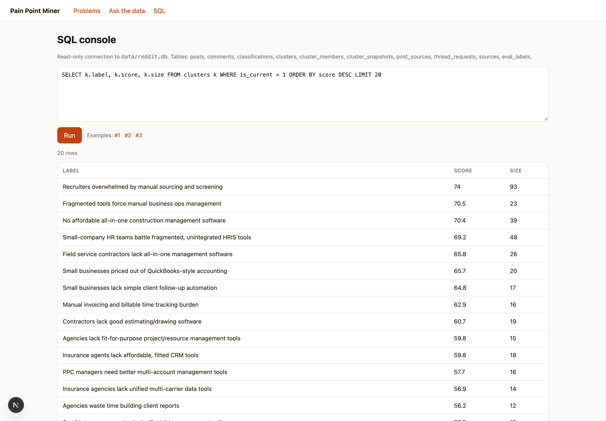
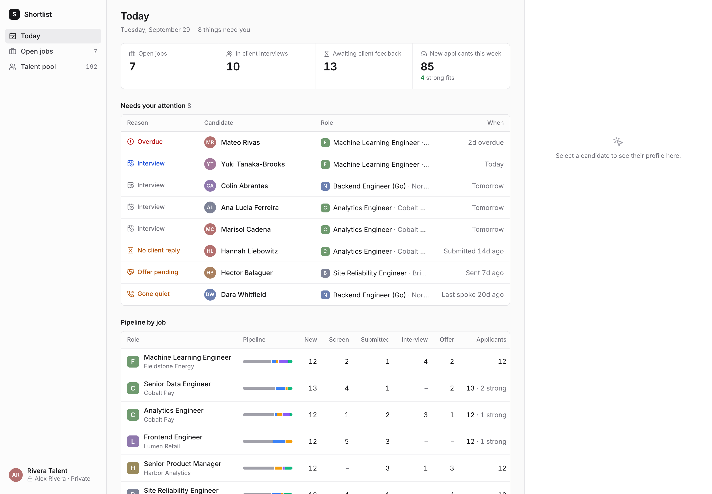

# Pain Point Miner

Finds business problems worth building AI products for, using what people actually complain about on Reddit.

It pulls posts from 47 small-business and professional subreddits. Claude classifies each post: is it a real pain point, would the poster pay to fix it, how badly do current tools serve them, and could AI solve it. The pain points are then embedded, clustered into distinct problems, and ranked. Every ranked problem links back to the posts behind it.



**Current dataset:** 43,066 posts and 146,412 comments from 47 subreddits. 5,111 posts are classified, giving 624 pain points in 36 clusters.

> **Status: pilot.** The classifier hasn't been checked against hand labels yet, so treat the rankings as a working pipeline, not as findings. The dashboard shows a banner saying so until at least 150 posts have been labeled (`npm run label`).

## How it works

```
Reddit RSS + web search ──► collect ──► SQLite (posts, comments)
                                            │
                     classify (Claude Haiku 4.5, Message Batches) ──► classifications
                                            │
                     embed (Voyage voyage-3.5) ──► sqlite-vec
                                            │
                     cluster (k-means) + describe (Claude Sonnet 5) ──► clusters
                                            │
                     score & rank ──► Next.js dashboard + chat over the data (Claude Opus 5.5)
```

1. **Collect.** Reddit closed self-service API access, so ingestion uses what's still open:
   - **Discover:** web search (You.com, or Brave as a fallback) for pain phrases such as *"is there a tool"*, *"so tedious"* and *"I would pay for"*, limited to each subreddit. The threads it finds are queued.
   - **Feeds:** `/r/{sub}/new/.rss` pages. The first run backfills about 1,000 posts per subreddit, and later runs only fetch what's new.
   - **Threads:** each queued thread's RSS feed, which returns the post plus its top comments in one request.

   Unauthenticated RSS allows about one request per 45–60 seconds, so the client paces itself by Reddit's rate-limit headers. Every step can be resumed and re-run safely.
2. **Classify.** Claude Haiku 4.5 reads each post and its top comments and returns structured JSON: `is_pain_point`, a one-sentence `problem_summary`, persona, industry, workflow category, and 0–3 scores for willingness to pay, how underserved the poster is, AI solvability and emotional intensity, each with an evidence quote. It also lists the tools the poster mentions. Requests go through the Message Batches API (half price) with the rubric prompt-cached. `estimate` gives the projected cost before anything is sent. As an example, classifying r/humanresources (964 posts) cost $1.57.
3. **Embed.** Each pain point's `problem_summary` is embedded with Voyage and stored in a sqlite-vec table.
4. **Cluster.** k-means groups similar pain points, and clusters smaller than 3 are dissolved. New pain points join their nearest cluster when they're similar enough (cosine ≥ 0.88 to the centroid), and `--full` re-clusters from scratch. Claude Sonnet 5 names each cluster, writes a problem statement, and picks representative quotes. A cluster is relabeled once it grows by 50%.
5. **Score.** Each cluster gets a 0–100 score from components that are normalized across all clusters. The weights live in [config/scoring.yaml](config/scoring.yaml):

   | Component | Weight | Measures |
   |---|---|---|
   | Frequency | 0.25 | log of the number of posts |
   | Willingness to pay | 0.20 | average of the 0–3 score |
   | AI solvability | 0.20 | average of the 0–3 score |
   | Underserved | 0.15 | average of the 0–3 score |
   | Spread | 0.10 | distinct subreddits (problems that cross industries score higher) |
   | Engagement | 0.10 | log-scaled comment activity (RSS has no upvote counts) |
   | Emotional intensity | 0.00 | shown on the dashboard but not used in the score |

6. **Evaluate.** `npm run label` is an interactive tool for hand-labeling random posts with the same rubric the classifier uses. `npm run eval` runs the current prompt on the labeled posts and reports precision and recall on `is_pain_point`, plus agreement on the scores. Predictions are cached per prompt version, so trying a new version of the prompt is fast.

## The dashboard

A Next.js app in [web/](web/) with four pages. It opens `data/reddit.db` read-only.

**Problems (`/`)** is the ranked table shown above, with the score breakdown for each cluster.

**Problem detail (`/cluster/[id]`)** shows the problem statement, personas, "in their words" quotes, and the subreddits, tools and AI capabilities mentioned. Below that is every member post with its summary, scores and similarity to the cluster, and each post links to the Reddit thread.



**Ask the data (`/chat`)** lets you ask questions in plain English. Claude Opus 5.5 answers using two tools, `sql_query` (read-only) and `semantic_search` (sqlite-vec), and cites the posts it relied on. Each question costs about $0.08–0.16.

**SQL (`/sql`)** is a read-only SQL console over the whole database.



## Shortlist: a demo built from the top finding

The top-ranked cluster was *Recruiters overwhelmed by manual sourcing and screening* (93 posts, score 74.0). Shortlist, in [demo/](demo/), is a clickable demo of a product for that problem, aimed at agency and solo recruiters. It includes a private talent pool you can search in plain English, resume parsing, job orders ranked against the pool, applicants ranked by AI fit, and a daily pipeline view. The data is seeded and fictional.



## Getting started

Requires Node 22+.

```sh
npm install
cp .env.example .env    # then fill in the keys below
npm run db:init         # create the schema and load config/sources.yaml
```

| Variable | Needed for |
|---|---|
| `REDDIT_USER_AGENT` | all collection (Reddit requires a descriptive user agent) |
| `YOU_API_KEY` or `BRAVE_SEARCH_API_KEY` | thread discovery |
| `ANTHROPIC_API_KEY` | classification, cluster labels, chat, reranked search |
| `VOYAGE_API_KEY` | embeddings and semantic search |
| `DB_PATH` | optional, defaults to `data/reddit.db` |

### Run the pipeline

```sh
npm run collect                     # discover + feeds + threads (slow: paced by Reddit's rate limit)
npm run classify -- estimate        # projected cost, free
npm run classify -- run             # submit batches, wait, import results
npm run embed
npm run cluster                     # incremental; add --full to re-cluster from scratch
npm run status                      # counts and recent runs
```

### Run the dashboard

```sh
cd web && npm install && npm run dev      # http://localhost:3000
```

### Run the Shortlist demo

```sh
cd demo && npm install
npm run seed && npm run seed:pipeline     # about $0.50 in API calls
npm run dev                               # http://localhost:3001
npm run reset                             # restore seeded state and move dates up to today
```

## Commands

| Command | What it does |
|---|---|
| `npm run collect -- [--only discover\|threads\|feeds] [--sub NAME] [--max-requests N]` | Ingest from Reddit. Resumable. |
| `npm run sources -- list` | List crawl sources |
| `npm run sources -- add r/Dentistry [--vertical healthcare]` | Add a subreddit, or a single thread by URL |
| `npm run sources -- add-search r/LawFirm "client intake"` | Add an extra discovery query for one subreddit |
| `npm run sources -- disable\|enable <id \| r/name>` | Turn a source off or on |
| `npm run classify -- estimate\|submit\|collect\|run [--sub NAME] [--limit N] [--random]` | Classify posts with Claude |
| `npm run embed` | Embed new or changed pain points |
| `npm run cluster -- [--full] [--no-label] [--k N]` | Cluster, rescore, snapshot and label |
| `npm run search -- "<question>" [--sub X] [--min-wtp N] [--rerank]` | Semantic search over pain points from the terminal |
| `npm run label -- [--target 200]` | Hand-label posts for the eval set |
| `npm run eval` | Score the classifier against the labels |
| `npm run status` | Dataset counts and recent runs |
| `npm test` / `npm run typecheck` | Unit tests (k-means, scoring, RSS parsing, discovery) and type check |

## Project layout

```
config/
  sources.yaml      subreddits by vertical, pain phrases, extra threads and searches
  scoring.yaml      ranking weights and clustering parameters
src/
  reddit/           RSS client, rate-limit pacing, ID helpers
  ingest/           collect: discover (You.com / Brave), feeds, threads
  sources/          source config, seeding and CLI
  analyze/          classify, embed, k-means, cluster, describe, score, search
  eval/             labeling tool and classifier eval
  db/               schema.sql and better-sqlite3 + sqlite-vec setup
web/                Pain Point Miner dashboard (Next.js)
demo/               Shortlist recruiter demo (Next.js)
docs/               screenshots
```

## Known limitations

- **No upvote counts.** RSS doesn't expose scores, so engagement is measured by comment activity and by how many distinct threads and subreddits raise a problem. The official API would plug in as another collector once access is approved.
- **Uneven classification coverage.** r/recruiting and r/humanresources are fully classified, while most other subreddits are about 8% classified. That inflates the recruiting cluster's score relative to the others.
- **The classifier isn't validated yet** (see Status above).
